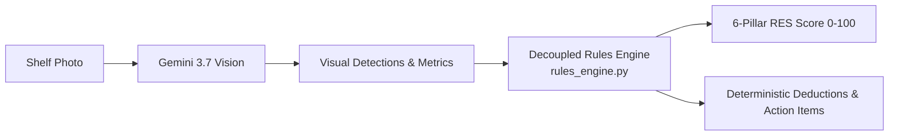

# Retail Execution Score (RES) — Mathematical Formula & Pillar Specification

This document provides the exact mathematical formulas, business justifications, and step-by-step scoring breakdown for the **6-Pillar Image-Only Retail Execution Scoring (RES)** engine implemented in [`app/services/rules_engine.py`](file:///c:/Users/HP/Desktop/MerchVision/MerchVision-PRAN-RFL/app/services/rules_engine.py).

---

## 1. Executive Overview

The **Retail Execution Score (RES)** is a deterministic 0–100 index measuring how effectively PRAN products are presented, stocked, and merchandised on a retail shelf fixture.

### Why is it "Image-Only"?
Traditional FMCG auditing relies on external ERP data or pre-configured store planograms that often fall out of sync with real-world store conditions. The MerchVision engine evaluates **only what is visually provable in the shelf photo**, decoupling AI visual perception from business scoring:



---

## 2. The 6-Pillar Score Matrix

The maximum score is **100 points**, distributed across 6 commercial pillars:

| Pillar # | Pillar Name | Max Points | Weight | Metric Source | Primary Commercial Objective |
| :---: | :--- | :---: | :---: | :--- | :--- |
| **1** | **Presence (Variety)** | **20 pts** | 20% | Distinct PRAN SKUs | Ensures assortment depth; stops single-product dumping |
| **2** | **Visibility (Share of Shelf)**| **25 pts** | 25% | Linear shelf width % | Secures brand dominance over competitors (V-Soy, Twister, etc.) |
| **3** | **Placement (Golden Zone)** | **20 pts** | 20% | Facings at eye level | Captures the prime eye-level shopper gaze tier |
| **4** | **Shelf Arrangement** | **15 pts** | 15% | AI arrangement index | Enforces facing alignment, fronting, and variant clustering |
| **5** | **Stock Health (Voids)** | **10 pts** | 10% | Empty gaps & voids | Detects out-of-stock risk and unreplenished shelf slots |
| **6** | **Price & Promo Visibility** | **10 pts** | 10% | Shelf talkers, tags | Ensures shopper price transparency and promotional impact |
| **Total**| **Composite RES** | **100 pts** | **100%** | **Deterministic Sum** | **Comprehensive Store Merchandising Health** |

---

## 3. Pillar-by-Pillar Formula & Logic

### Pillar 1: Presence (Assortment Variety) — Max 20 Points
* **File Reference:** [`app/services/rules_engine.py:137-150`](file:///c:/Users/HP/Desktop/MerchVision/MerchVision-PRAN-RFL/app/services/rules_engine.py#L137-L150)
* **Objective:** Measures whether the store stocks an adequate range of distinct PRAN SKUs rather than just repeating one flavor.
* **Mathematical Formula:**
  $$\text{Presence Score} = \min\Big(20.0,\, 8.0 + (\text{distinct\_count} \times 3.0)\Big)$$
* **Points Breakdown:**
  * **Base points:** $8.0\text{ pts}$ awarded automatically if at least 1 PRAN product is confirmed.
  * **Incremental points:** $+3.0\text{ pts}$ per unique PRAN product variant detected.
  * **Cap:** Max $20.0\text{ pts}$ (reached at 4 or more distinct PRAN SKUs).
* **Deduction Threshold:** If $\text{Presence Score} < 14.0\text{ pts}$ (fewer than 2 distinct SKUs), a deduction is flagged:
  $$\text{Deduction} = -(20.0 - \text{Presence Score})\text{ pts}$$

---

### Pillar 2: Visibility / Share of Shelf (SoS) — Max 25 Points
* **File Reference:** [`app/services/rules_engine.py:152-171`](file:///c:/Users/HP/Desktop/MerchVision/MerchVision-PRAN-RFL/app/services/rules_engine.py#L152-L171)
* **Objective:** Measures the linear width PRAN occupies on the fixture relative to competitors.
* **Mathematical Formula:**
  $$\text{SoS Score} = \min\left(25.0,\, \frac{\text{actual\_sos}}{\text{benchmark\_sos}} \times 25.0\right)$$
  * Where $\text{benchmark\_sos} = 30.0\%$ (configurable reference benchmark in `.env`).
* **Points Breakdown:**
  * If PRAN shelf share reaches or exceeds $30.0\%$, the full $25.0\text{ pts}$ is awarded.
  * If PRAN shelf share is below $30.0\%$, points are awarded proportionally:
    $$\text{SoS Score} = \frac{\text{actual\_sos}}{30.0} \times 25.0$$
* **Deduction Threshold:** If $\text{actual\_sos} < 15.0\%$ (critical visibility threshold), a penalty is logged:
  $$\text{Deduction} = -(25.0 - \text{SoS Score})\text{ pts}$$

---

### Pillar 3: Placement (Golden Zone / Eye Level) — Max 20 Points
* **File Reference:** [`app/services/rules_engine.py:173-194`](file:///c:/Users/HP/Desktop/MerchVision/MerchVision-PRAN-RFL/app/services/rules_engine.py#L173-L194)
* **Objective:** The "Golden Zone" (middle/eye-level shelf tier) drives over 60% of retail sales. Products placed strictly on bottom or top tiers suffer lower conversion.
* **Mathematical Formula:**
  $$\text{eye\_ratio} = \frac{\text{PRAN Facings at Eye Level}}{\text{Total PRAN Facings}}$$
  $$\text{Placement Score} = \text{round}(\text{eye\_ratio} \times 20.0,\, 1)$$
* **Points Breakdown:**
  * $100\%$ of PRAN facings at eye level $\rightarrow 20.0\text{ pts}$.
  * $50\%$ of PRAN facings at eye level $\rightarrow 10.0\text{ pts}$.
  * $0\%$ of PRAN facings at eye level $\rightarrow 0.0\text{ pts}$.
* **Deduction Threshold:** If $\text{eye\_ratio} < 0.35$ (less than 35% of PRAN inventory at eye level):
  $$\text{Deduction} = -(20.0 - \text{Placement Score})\text{ pts}$$

---

### Pillar 4: Shelf Arrangement Index — Max 15 Points
* **File Reference:** [`app/services/rules_engine.py:196-216`](file:///c:/Users/HP/Desktop/MerchVision/MerchVision-PRAN-RFL/app/services/rules_engine.py#L196-L216)
* **Objective:** Evaluates visual merchandising discipline: label forward-facing, neat alignment, lack of tip-overs, and variant block grouping.
* **Mathematical Formula:**
  $$\text{Arrangement Score} = \text{round}\left(\frac{\text{raw\_arr}}{100.0} \times 15.0,\, 1\right)$$
  * Where $\text{raw\_arr}$ is the visual arrangement index assessed by vision perception on a $0\text{--}100$ scale.
* **Points Breakdown:**
  * Assessed at $100/100 \rightarrow 15.0\text{ pts}$.
  * Assessed at $85/100 \rightarrow 12.75 \rightarrow 12.8\text{ pts}$.
  * Assessed at $60/100 \rightarrow 9.0\text{ pts}$.
* **Deduction Threshold:** If $\text{raw\_arr} < 70.0$, a deduction is logged:
  $$\text{Deduction} = -(15.0 - \text{Arrangement Score})\text{ pts}$$

---

### Pillar 5: Stock Health (Voids & Gaps) — Max 10 Points
* **File Reference:** [`app/services/rules_engine.py:45-48`, `218-236`](file:///c:/Users/HP/Desktop/MerchVision/MerchVision-PRAN-RFL/app/services/rules_engine.py#L45-L48)
* **Objective:** Identifies shelf stockouts, empty slots, and missing facings that directly result in lost revenue.
* **Mathematical Formula:**
  $$\text{Stock Health Score} = \max\Big(0.0,\, 10.0 - \min(\text{empty\_pct} \times 0.2,\, 5.0) - \min(\text{gaps\_count} \times 2.0,\, 5.0)\Big)$$
* **Points Breakdown:**
  * Starts at base $10.0\text{ pts}$.
  * Deducts $0.2\text{ pts}$ per $1\%$ of empty shelf share (up to $-5.0\text{ pts}$).
  * Deducts $2.0\text{ pts}$ per distinct visible void/gap near PRAN products (up to $-5.0\text{ pts}$).
  * Zero voids + zero empty space $\rightarrow 10.0 / 10.0\text{ pts}$.

---

### Pillar 6: Price & Promotion Visibility — Max 10 Points
* **File Reference:** [`app/services/rules_engine.py:51-54`, `238-254`](file:///c:/Users/HP/Desktop/MerchVision/MerchVision-PRAN-RFL/app/services/rules_engine.py#L51-L54)
* **Objective:** Customers must be able to clearly identify the price; promotional signage (shelf talkers, wobblers, danglers) boosts impulse purchases.
* **Mathematical Formula:**
  $$\text{Price Promo Score} = \max\Big(0.0,\, \min(10.0,\, (\text{price\_tag\_ratio} \times 7.0) + (3.0 \text{ if promo\_detected else } 0.0))\Big)$$
* **Points Breakdown:**
  * **Price tag coverage (Max 7 pts):** Proportion of distinct PRAN items with a readable price label:
    $$\text{price\_tag\_ratio} = \frac{\text{priced PRAN SKUs}}{\text{distinct PRAN SKUs}} \times 7.0\text{ pts}$$
  * **Promotional material (Max 3 pts):** Full $+3.0\text{ pts}$ awarded if promotional signage, shelf talker, or wobbler is detected.
* **Deductions:**
  * If $\text{promo\_detected} = \text{False} \rightarrow$ Deducts $-3.0\text{ pts}$ (`No visible promotional signage, talkers, or wobblers detected`).
  * If $\text{price\_tag\_ratio} < 0.5 \rightarrow$ Deducts $-(7.0 \times (1.0 - \text{price\_tag\_ratio}))\text{ pts}$.

---

## 4. Composite Score & Grading Tiers

### Total RES Calculation:
$$\text{RES} = \text{round}\left(\frac{\sum \text{Pillars Earned}}{\sum \text{Max Possible}} \times 100.0,\, 1\right)$$

### Performance Tiers:
| Score Range | Grade Label | Audit Status | Action Required |
| :---: | :--- | :--- | :--- |
| **85.0 – 100.0** | **Excellent** | `acceptable` | Shelf standards fully compliant. Maintain execution. |
| **70.0 – 84.9** | **Good** | `acceptable` | Minor adjustments recommended (e.g., add shelf talker). |
| **55.0 – 69.9** | **Needs Attention** | `needs_attention` | Moderate non-compliance; merchandiser must rectify. |
| **0.0 – 54.9** | **Critical Action Required** | `needs_attention` | Urgent merchandiser intervention needed (low share, poor tier). |
| **Null (None)** | **No PRAN Detected** | `no_pran_detected` | Photo lacks PRAN products; verify store section. |

---

## 5. Walkthrough of Your Exact Audit (`54/100`)

Here is the exact mathematical step-by-step verification of the audit you ran on **`img_1790377005125.jpg`**:

### Observed Shelf Facts:
* **PRAN Products:** 2 facings (`PRAN Tamarind Drink`, `PRAN Sour Plum Drink`), both placed on **middle** tier.
* **Competitor Products:** 21 facings (`V-Soy`, `Tropicana Twister`, `Adem Sari`, `Big Bee`, `Yeo's`, `Injoy`).
* **PRAN Linear Share (SoS):** $12.0\%$ (Competitors occupy $88.0\%$).
* **Golden Zone (Eye-Level) Facings:** $0$ of $2$ PRAN items are at eye level ($0\%$).
* **Shelf Arrangement Index:** $85 / 100$.
* **Visible Gaps / Voids:** $0$ ($0.0\%$ empty shelf).
* **Price Tags:** Both PRAN drinks have visible price tags ($100\%$ coverage).
* **Promotions / Wobblers:** None visible ($0$).

---

### Step-by-Step Mathematical Computation:

```text
┌─────────────────────────────────────────────────────────────────────────────────────────────┐
│ 1. PRESENCE (Assortment Variety)                                                           │
│    Formula: 8.0 + (distinct_count * 3.0)                                                    │
│    Calculation: 8.0 + (2 * 3.0) = 8.0 + 6.0                                                │
│    Score Earned: 14.0 / 20.0 pts                                                            │
│    Unearned: -6.0 pts (Only 2 variants stocked)                                            │
├─────────────────────────────────────────────────────────────────────────────────────────────┤
│ 2. VISIBILITY (Share of Shelf)                                                             │
│    Formula: (actual_sos / benchmark_sos) * 25.0                                            │
│    Calculation: (12.0 / 30.0) * 25.0 = 0.40 * 25.0                                         │
│    Score Earned: 10.0 / 25.0 pts                                                            │
│    Deduction: [-] -15.0 pts: Low PRAN shelf share (12.0% vs reference benchmark 30.0%)     │
├─────────────────────────────────────────────────────────────────────────────────────────────┤
│ 3. PLACEMENT (Golden Zone / Eye Level)                                                     │
│    Formula: (eye_facings / total_facings) * 20.0                                            │
│    Calculation: (0 / 2) * 20.0 = 0.0 * 20.0                                                 │
│    Score Earned: 0.0 / 20.0 pts                                                             │
│    Deduction: [-] -20.0 pts: Weak Golden Zone placement (0% of PRAN items at eye level)     │
├─────────────────────────────────────────────────────────────────────────────────────────────┤
│ 4. SHELF ARRANGEMENT                                                                       │
│    Formula: (raw_arrangement / 100.0) * 15.0                                                │
│    Calculation: (85.0 / 100.0) * 15.0 = 0.85 * 15.0 = 12.75                                 │
│    Score Earned: 12.8 / 15.0 pts (rounded to 1 decimal)                                    │
│    Unearned: -2.2 pts (Minor facing alignment irregularity)                                │
├─────────────────────────────────────────────────────────────────────────────────────────────┤
│ 5. STOCK HEALTH (Voids & Gaps)                                                             │
│    Formula: 10.0 - min(empty_pct * 0.2, 5.0) - min(gaps * 2.0, 5.0)                         │
│    Calculation: 10.0 - 0.0 - 0.0                                                            │
│    Score Earned: 10.0 / 10.0 pts (Flawless full stock)                                     │
├─────────────────────────────────────────────────────────────────────────────────────────────┤
│ 6. PRICE & PROMO VISIBILITY                                                                │
│    Formula: (price_tag_ratio * 7.0) + (3.0 if promo else 0.0)                               │
│    Calculation: (1.0 * 7.0) + 0.0                                                           │
│    Score Earned: 7.0 / 10.0 pts                                                             │
│    Deduction: [-] -3.0 pts: No visible promotional signage, talkers, or wobblers detected   │
└─────────────────────────────────────────────────────────────────────────────────────────────┘
```

### Final Sum:
$$\text{Earned Points} = 14.0 + 10.0 + 0.0 + 12.8 + 10.0 + 7.0 = 53.8\text{ points}$$
$$\text{Final RES Score} = \text{round}(53.8) = \mathbf{54 / 100}$$

### Grade Determination:
* Since $53.8 < 55.0$, the grade is automatically classified as **"Critical Action Required"**.

### Deductions Reconciliation:
```text
  100.0  (Maximum Base Score)
-  15.0  (Pillar 2 Deduction: 12.0% SOS vs 30.0% benchmark)
-  20.0  (Pillar 3 Deduction: 0% Golden Zone eye level)
-   3.0  (Pillar 6 Deduction: Missing promotional wobbler/signage)
-   6.0  (Pillar 1 Shortfall: 14.0 earned out of 20.0)
-   2.2  (Pillar 4 Shortfall: 12.8 earned out of 15.0)
───────
   53.8  pts → Rounded to 54 / 100
```

---

## 6. How the Field Merchandiser Improves this Shelf

Because each deduction maps directly to an image-provable condition, the merchandiser has an exact checklist to raise this store's score from **54** to **85+** (Verified via `POST /merchandising/verify`):

1. **Move PRAN drinks to eye-level (+20.0 pts):** Shift Tamarind Drink and Sour Plum Drink to the prime eye-level tier $\rightarrow$ Placement jumps from $0 \rightarrow 20.0$.
2. **Add 2 more PRAN facings / flavors (+9.3 pts):** Expands SoS from $12\% \rightarrow 20\%$ and distinct SKUs from $2 \rightarrow 3$.
3. **Hang a PRAN promotional wobbler or shelf talker (+3.0 pts):** Price & Promo jumps from $7.0 \rightarrow 10.0$.
4. **Projected Score after fixes:** **$86 / 100$ (Grade: Excellent)**.
